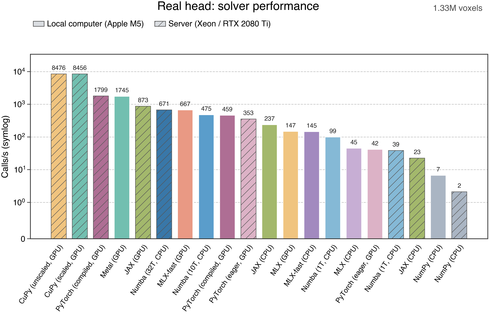
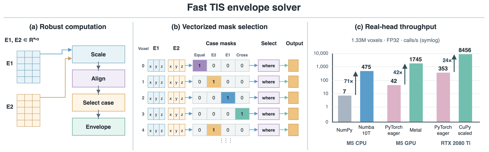

<h1 align="center">Fast TIS Envelope</h1>

<div align="center">

**A fast, portable solver for the maximum temporal interference stimulation envelope.**

[](pyproject.toml)
[](LICENSE)
[](pyproject.toml)
[](docs/en/optimizations.md)
[](docs/en/installation.md)
[](docs/en/installation.md)

[English](README.md) · [简体中文](README_zh.md) · [Documentation](docs/en/index.md) · [Optimizations](docs/en/optimizations.md) · [Performance](docs/en/performance.md)

🧠 **TIS envelope** · ⚙️ **Multithreaded CPU** · ⚡ **Metal / CUDA** · 🐍 **Unified Python API**

</div>

## ⚡ Performance



On 1,328,756 real-head voxels, the Metal kernel reached **1,745 calls/s** on Apple M5 and the scaled CuPy kernel reached **8,456 calls/s** on an RTX 2080 Ti. Numba reached **475 calls/s** with 10 threads on M5 and **671 calls/s** with 32 threads on the Xeon server.

Measurements use FP32 inputs and synchronized forward calls, with 5 warmups and the median of 31 samples. Input preparation, transfer and initial compilation are excluded. CPU and GPU runs were measured separately. Timings measure backend calls directly. The figure includes the historical PyTorch baseline formula; details and measurements are in [Performance](docs/en/performance.md).

## 🧠 Features

- Compute maximum TIS envelope amplitudes from paired 3-D fields.
- One Python function for NumPy, Numba, JAX, PyTorch, MLX, Metal and CuPy.
- Select the backend and device explicitly, or use automatic dispatch.
- Scaled arithmetic for zero, opposite, nearly equal and widely differing fields.
- Numba CPU parallelism and fused, per-voxel Metal and CUDA kernels.
- Optional JIT or graph compilation; optional GPU dependencies are loaded on demand.

## 🔬 Algorithm and optimization



The solver scales and orients each field pair, evaluates the applicable geometric case, and returns one envelope amplitude per voxel. Array backends express the cases with masks; the fused GPU kernels execute independent voxel calculations in parallel.

[Algorithm](docs/en/algorithm.md) · [Optimization guide](docs/en/optimizations.md) · [Editable draw.io](benchmark_results/envelope_optimization.drawio) · [Vector PDF](benchmark_results/envelope_optimization.pdf)

## 📦 Installation

The distribution and Python import are named `fast_tis_envelope`. Python 3.9+ is required. Install from the project root with `python -m pip install .`, or build a wheel:

```bash
python -m pip wheel . --no-deps -w dist
python -m pip install ./dist/fast_tis_envelope-0.2.0-py3-none-any.whl
```

For CPU acceleration or Apple Metal, install the corresponding extra:

```bash
python -m pip install './dist/fast_tis_envelope-0.2.0-py3-none-any.whl[cpu]'
python -m pip install './dist/fast_tis_envelope-0.2.0-py3-none-any.whl[metal]'
```

NVIDIA CUDA uses CuPy; choose a CuPy build compatible with the CUDA environment. JAX and PyTorch are optional. See [installation](docs/en/installation.md) for CUDA, optional extras and source installation.

## 🚀 Quick start

```python
import numpy as np
from fast_tis_envelope import envelope

e1 = np.array([[1., 0., 0.], [1., 0., 0.]], dtype=np.float32)
e2 = np.array([[0., 1., 0.], [1., 0., 0.]], dtype=np.float32)

result = envelope(e1, e2)  # [1.4142135, 2.0]
```

For fields of shape `(N, 3)`, the result has shape `(N,)`. Host arrays use Numba on CPU when available, otherwise NumPy. Native framework arrays use their own backend.

## 🐍 Python API

```python
from fast_tis_envelope import envelope, resolve_backend

result = envelope(e1, e2, backend="numba", device="cpu", parallel=True)
result = envelope(e1, e2, backend="metal", device="mps:0")
result = envelope(e1, e2, backend="cupy", device="cuda:0")
result = envelope(e1, e2, backend="torch", device="cuda:0", compile=True)
print(resolve_backend(e1, e2, backend="auto", device="auto"))
```

Device indices start at zero and follow the devices visible to the selected framework. Explicit placement transfers inputs as needed. See [usage](docs/en/usage.md) for input types, precision, compilation and device selection.

## 📖 Documentation

- [Installation](docs/en/installation.md): wheel, source and backend dependencies.
- [Usage](docs/en/usage.md): API, device selection and compilation.
- [Algorithm](docs/en/algorithm.md): maximum envelope and piecewise evaluation.
- [Optimizations](docs/en/optimizations.md): numerical formulation, parallelism and fused kernels.
- [Performance](docs/en/performance.md): hardware, measurements, figures and reproduction.
- [Version 0.1.0](https://github.com/ayakacxy/TIS_envelope/releases/tag/v0.1.0): original JAX release.

## 📄 Citation and license

If you use this software, please cite **Chen et al., “Multi-Channel Temporal Interference Retinal Stimulation Based on Reinforcement Learning,” IEEE JBHI, 2026, 30(3): 2101–2112**, [doi:10.1109/JBHI.2025.3605434](https://doi.org/10.1109/JBHI.2025.3605434).

```bibtex
@article{chen2026multi,
  title   = {{Multi-Channel Temporal Interference Retinal Stimulation Based on Reinforcement Learning}},
  author  = {Chen, Xiayu and Chan, Wennan and Meng, Yingqiang and Liu, Runze and
             Yu, Yueyi and Hu, Sheng and Han, Jijun and Wang, Xiaoxiao and
             Zhou, Jiawei and Qiu, Bensheng and Wang, Yanming},
  journal = {IEEE Journal of Biomedical and Health Informatics},
  year    = {2026},
  volume  = {30},
  number  = {3},
  pages   = {2101--2112},
  month   = mar,
  doi     = {10.1109/JBHI.2025.3605434}
}
```

Fast TIS Envelope is licensed under [GNU GPL v3.0 only](LICENSE). The original v1 snapshot retains its [MIT license](licenses/LICENSE-v1-MIT.txt).
