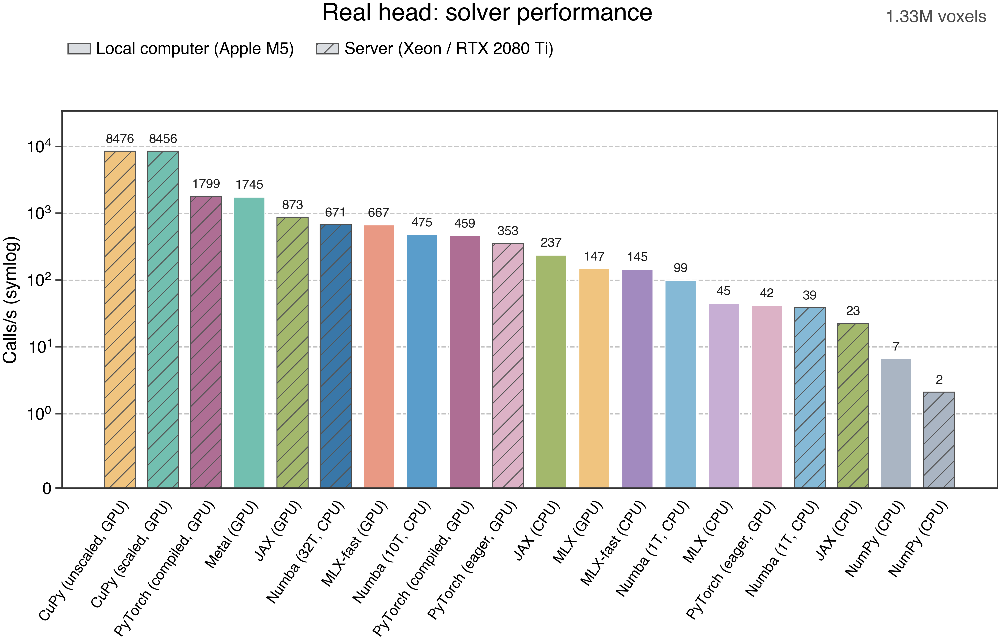
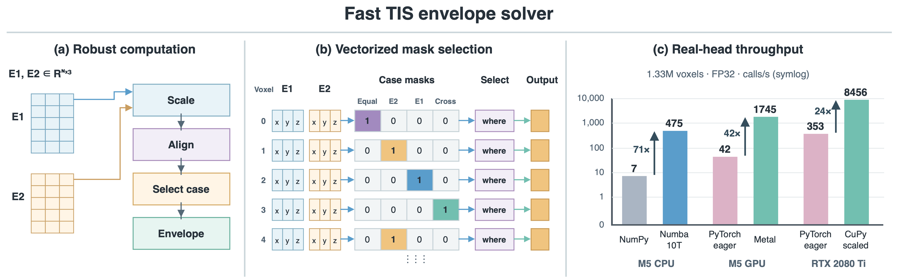

<h1 align="center">Fast TIS Envelope</h1>

<div align="center">

**快速、跨平台的时域干涉刺激最大包络求解器。**

[](pyproject.toml)
[](LICENSE)
[](pyproject.toml)
[](docs/zh-CN/optimizations.md)
[](docs/zh-CN/installation.md)
[](docs/zh-CN/installation.md)

[English](README.md) · [简体中文](README_zh.md) · [文档](docs/zh-CN/index.md) · [优化实现](docs/zh-CN/optimizations.md) · [性能测试](docs/zh-CN/performance.md)

🧠 **TIS 包络** · ⚙️ **多线程 CPU** · ⚡ **Metal / CUDA** · 🐍 **统一 Python 接口**

</div>

## ⚡ 性能



在 1,328,756 个真实头模型体素上，Apple M5 的 Metal 内核达到 **1,745 次/秒**，RTX 2080 Ti 的缩放版 CuPy 内核达到 **8,456 次/秒**。Numba 在 M5 上使用 10 线程达到 **475 次/秒**，在 Xeon 服务器上使用 32 线程达到 **671 次/秒**。

测量使用 FP32 输入和同步的前向计算，预热 5 次后取 31 次测量的中位数；不包含输入准备、传输和首次编译。CPU 与 GPU 分别测量，计时直接调用各后端。图中的 PyTorch 使用历史基准公式；测试数据与条件见[性能文档](docs/zh-CN/performance.md)。

## 🧠 功能

- 从两组三维电场计算最大 TIS 包络幅值。
- 通过统一 Python 函数调用 NumPy、Numba、JAX、PyTorch、MLX、Metal 和 CuPy。
- 自动选择后端，也可指定后端和设备编号。
- 使用缩放计算处理零场、反向、近相等和幅值差异较大的电场。
- 支持 Numba CPU 并行，以及逐体素并行的 Metal 和 CUDA 融合内核。
- 支持 JIT 或计算图编译；可选 GPU 依赖按需加载。

## 🔬 算法与优化



求解器对每组电场进行缩放和方向调整，根据几何条件选择对应结果，每个体素输出一个包络幅值。数组后端使用掩码表达条件，自定义 GPU 内核并行计算各体素。

[算法原理](docs/zh-CN/algorithm.md) · [优化说明](docs/zh-CN/optimizations.md) · [可编辑 draw.io](benchmark_results/envelope_optimization.drawio) · [矢量 PDF](benchmark_results/envelope_optimization.pdf)

## 📦 安装

Python 发行包和导入名均为 `fast_tis_envelope`，需要 Python 3.9 或更新版本。在项目根目录运行 `python -m pip install .`，也可以构建 wheel：

```bash
python -m pip wheel . --no-deps -w dist
python -m pip install ./dist/fast_tis_envelope-0.2.0-py3-none-any.whl
```

需要 CPU 加速或 Apple Metal 时，选择相应依赖：

```bash
python -m pip install './dist/fast_tis_envelope-0.2.0-py3-none-any.whl[cpu]'
python -m pip install './dist/fast_tis_envelope-0.2.0-py3-none-any.whl[metal]'
```

NVIDIA CUDA 使用 CuPy，请按 CUDA 环境选择对应构建。JAX 和 PyTorch 均为可选依赖。CUDA、其他依赖和源码安装方法见[安装说明](docs/zh-CN/installation.md)。

## 🚀 快速开始

```python
import numpy as np
from fast_tis_envelope import envelope

e1 = np.array([[1., 0., 0.], [1., 0., 0.]], dtype=np.float32)
e2 = np.array([[0., 1., 0.], [1., 0., 0.]], dtype=np.float32)

result = envelope(e1, e2)  # [1.4142135, 2.0]
```

输入电场形状为 `(N, 3)`，输出形状为 `(N,)`。主机数组默认使用 Numba CPU，未安装时使用 NumPy；框架数组默认使用其自身后端。

## 🐍 Python 接口

```python
from fast_tis_envelope import envelope, resolve_backend

result = envelope(e1, e2, backend="numba", device="cpu", parallel=True)
result = envelope(e1, e2, backend="metal", device="mps:0")
result = envelope(e1, e2, backend="cupy", device="cuda:0")
result = envelope(e1, e2, backend="torch", device="cuda:0", compile=True)
print(resolve_backend(e1, e2, backend="auto", device="auto"))
```

设备编号从 0 开始，按对应框架可见的设备顺序编号。显式选择设备时，输入会按需迁移。输入类型、精度、编译和设备选择见[使用说明](docs/zh-CN/usage.md)。

## 📖 文档

- [安装说明](docs/zh-CN/installation.md)：wheel、源码与后端依赖。
- [使用说明](docs/zh-CN/usage.md)：接口、设备选择与编译。
- [算法原理](docs/zh-CN/algorithm.md)：最大包络定义与分段计算。
- [优化实现](docs/zh-CN/optimizations.md)：数值计算、并行与融合内核。
- [性能测试](docs/zh-CN/performance.md)：硬件、测量、图表与复现。
- [v0.1.0 版本](https://github.com/ayakacxy/TIS_envelope/releases/tag/v0.1.0)：原始 JAX 版本。

## 📄 引用与许可

使用本项目时，请引用 **Chen 等，Multi-Channel Temporal Interference Retinal Stimulation Based on Reinforcement Learning，IEEE JBHI，2025**，[doi:10.1109/JBHI.2025.3605434](https://doi.org/10.1109/JBHI.2025.3605434)。

<details>
<summary>BibTeX</summary>

```bibtex
@article{chen2025multi,
  title={Multi-Channel Temporal Interference Retinal Stimulation Based on Reinforcement Learning},
  author={Chen, Xiayu and Chan, Wennan and Meng, Yingqiang and Liu, Runze and Yu, Yueyi and Hu, Sheng and Han, Jijun and Wang, Xiaoxiao and Zhou, Jiawei and Qiu, Bensheng and others},
  journal={IEEE Journal of Biomedical and Health Informatics},
  year={2025},
  doi={10.1109/JBHI.2025.3605434}
}
```

</details>

Fast TIS Envelope 采用 [GNU GPL v3.0 only](LICENSE)。原始 v1 快照保留其 [MIT 许可](licenses/LICENSE-v1-MIT.txt)。
