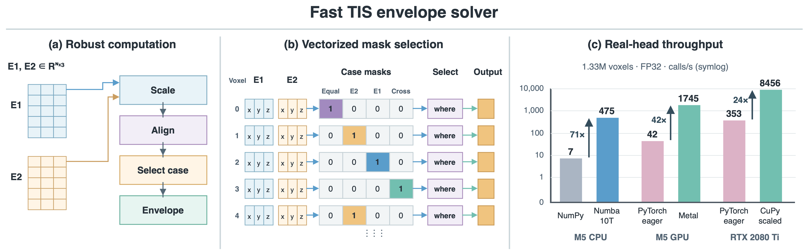

# Implementation optimizations

[English](optimizations.md) · [简体中文](../zh-CN/optimizations.md) · [Documentation](index.md)

[Editable draw.io](../../benchmark_results/envelope_optimization.drawio) · [Vector PDF](../../benchmark_results/envelope_optimization.pdf)

- **Scaled arithmetic:** scale the two fields independently and normalize their difference to reduce overflow and underflow. The piecewise expression handles zero, equal and opposite fields.
- **Vectorized cases:** array implementations use masks and selection to evaluate the geometric cases over all voxels.
- **CPU parallelism:** Numba compiles serial and `prange` kernels. The caller can select parallel execution and control the thread pool.
- **Fused GPU kernels:** the Metal and CuPy CUDA implementations calculate one voxel per GPU thread, combining the case selection and envelope calculation in one custom kernel.
- **Device execution:** keep framework arrays on their device across calls and synchronize when measuring throughput. Metal reads supported strided MLX views directly; CuPy's CUDA kernel copies noncontiguous inputs to a contiguous layout.

The figure's performance panel compares selected historical benchmark implementations, including the original PyTorch eager formula. [Performance](performance.md) gives the measurement conditions.
