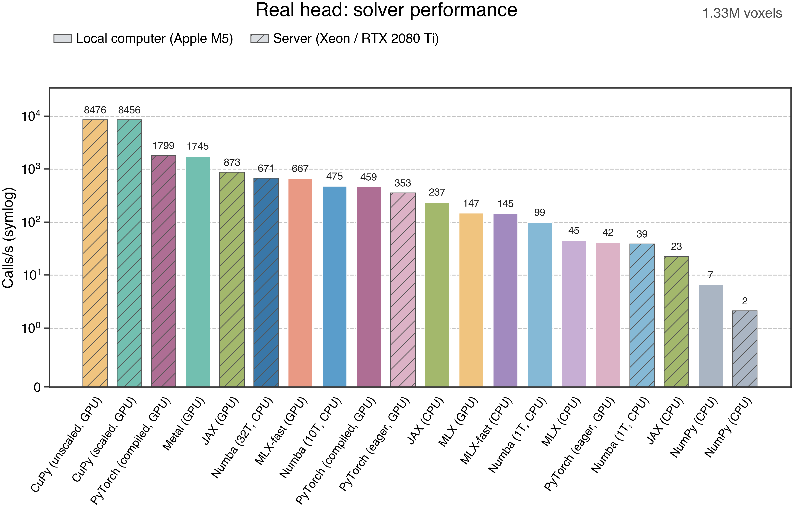

# Performance

[English](performance.md) · [简体中文](../zh-CN/performance.md) · [Documentation](index.md)

## Benchmark setup

The benchmark uses the same real-head electric fields: two FP32 arrays of **1,328,756 voxels** each. One call solves the complete field. Calls per second are calculated from the median time per call and rounded to integers.

- **Local:** Apple M5, with 10 threads for parallel Numba and Apple Metal for GPU execution.
- **Server:** dual Intel Xeon Gold 6230 CPUs and an NVIDIA RTX 2080 Ti; parallel Numba uses 32 threads.
- **Timing:** 5 warmups and 31 randomized, synchronized measurements. Input preparation, device transfer and initial compilation are excluded. The benchmark calls backend implementations directly; CPU and GPU run separately.
- **Validation:** every method uses the same input and is compared with NumPy float64 computed from that FP32 input. Server CPU processes are restricted to 32 distinct physical cores; JAX manages its threads within that affinity.

## Real-head results



| Apple M5 | Calls/s | Xeon / RTX 2080 Ti | Calls/s |
| --- | ---: | --- | ---: |
| Metal GPU | 1,745 | CuPy GPU, unscaled | 8,476 |
| MLX GPU, fast | 667 | CuPy GPU, scaled | 8,456 |
| Numba CPU, 10 threads | 475 | PyTorch GPU, compiled | 1,799 |
| PyTorch GPU, compiled | 459 | JAX GPU | 873 |
| JAX CPU | 237 | Numba CPU, 32 threads | 671 |
| MLX GPU | 147 | PyTorch GPU, eager | 353 |
| MLX CPU, fast | 145 | Numba CPU, 1 thread | 39 |
| Numba CPU, 1 thread | 99 | JAX CPU | 23 |
| MLX CPU | 45 | NumPy CPU | 2 |
| PyTorch GPU, eager | 42 | — | — |
| NumPy CPU | 7 | — | — |

PyTorch timings use the original benchmark formula. The unscaled CuPy and MLX-fast paths are comparison implementations for ordinary field magnitudes; the other scaled implementations use the stable solver. Results reflect the listed hardware, software, thread counts and input.

[Ranking PDF](../../benchmark_results/real_head_all_methods.pdf) · [Optimization schematic PDF](../../benchmark_results/envelope_optimization.pdf) · [Editable schematic](../../benchmark_results/envelope_optimization.drawio)

## Platform figures

| Platform | CPU | GPU | CPU / GPU comparison |
| --- | --- | --- | --- |
| Apple M5 | [PDF](../../benchmark_results/cpu_performance.pdf) · [PNG](../../benchmark_results/cpu_performance.png) | [PDF](../../benchmark_results/gpu_performance.pdf) · [PNG](../../benchmark_results/gpu_performance.png) | [PDF](../../benchmark_results/cpu_gpu_comparison.pdf) · [PNG](../../benchmark_results/cpu_gpu_comparison.png) |
| Xeon / RTX 2080 Ti | [PDF](../../benchmark_results/server_cpu_performance.pdf) · [PNG](../../benchmark_results/server_cpu_performance.png) | [PDF](../../benchmark_results/server_gpu_performance.pdf) · [PNG](../../benchmark_results/server_gpu_performance.png) | [PDF](../../benchmark_results/server_cpu_gpu_comparison.pdf) · [PNG](../../benchmark_results/server_cpu_gpu_comparison.png) |

Platform figures include throughput, time and numerical error over synthetic input sizes, along with the real-head results. [Optimizations](optimizations.md) describes the Metal and CUDA kernels.

## Data and plotting

The measurement JSON files contain individual timings, errors, hardware and software information, input hashes and source hashes:

- Apple M5: [CPU](../../benchmark_results/cpu_measurements_jax_2026-11-03.json) · [GPU](../../benchmark_results/gpu_measurements_torch_compiled_2026-11-03.json)
- Xeon / RTX 2080 Ti: [CPU](../../benchmark_results/server_cpu_base_final.json) · [CPU 32 threads](../../benchmark_results/server_cpu32_final.json) · [GPU](../../benchmark_results/server_gpu_final.json)

Install Matplotlib with `python -m pip install matplotlib`, then run this command from the project root to redraw the ranking:

```bash
python benchmarks/plot_real_head_all.py \
  --local-cpu benchmark_results/cpu_measurements_jax_2026-11-03.json \
  --local-gpu benchmark_results/gpu_measurements_torch_compiled_2026-11-03.json \
  --server-cpu benchmark_results/server_cpu_base_final.json \
  --server-cpu32 benchmark_results/server_cpu32_final.json \
  --server-gpu benchmark_results/server_gpu_final.json \
  --output-dir benchmark_outputs
```

`benchmarks/plot_cpu_gpu.py` and `benchmarks/plot_server_cpu_gpu.py` generate the platform figures; run either script with `--help` for arguments. `benchmarks/benchmark_cpu_gpu.py` measures synthetic data and accepts an optional pair of `(N, 3)` `.npy` fields. `benchmarks/benchmark_server_cpu_gpu.py` additionally requires a field pair and the original CuPy baseline source via `--existing-cupy-source`; use `--help` for details. The real-head fields are not included in the repository.
