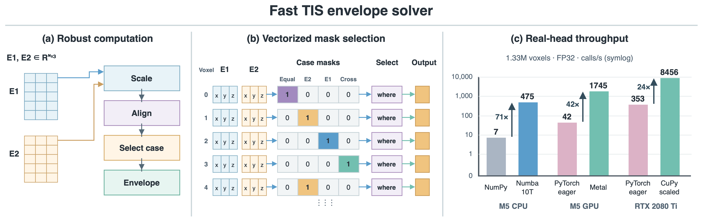

# 优化实现

[English](../en/optimizations.md) · [简体中文](optimizations.md) · [文档](index.md)

[可编辑 draw.io](../../benchmark_results/envelope_optimization.drawio) · [矢量 PDF](../../benchmark_results/envelope_optimization.pdf)

- **缩放计算**：分别缩放两组电场，并对差向量归一化，减少上溢与下溢；分段公式处理零场、相等和反向电场。
- **掩码并行**：数组实现通过掩码和选择操作，批量计算各体素的几何条件。
- **CPU 并行**：Numba 编译串行和 `prange` 并行内核，支持选择执行方式和设置线程池。
- **GPU 融合内核**：Metal 和 CuPy CUDA 内核使用一个 GPU 线程处理一个体素，将条件判断与包络计算合并到单个自定义内核。
- **设备执行**：框架数组可跨调用保留在设备上，吞吐量测量时再同步。Metal 直接读取支持的非连续 MLX 视图；CuPy CUDA 内核会将非连续输入转换为连续布局。

图中的性能部分对比了部分历史基准实现，包括原始 PyTorch eager 公式。测量条件见[性能文档](performance.md)。
