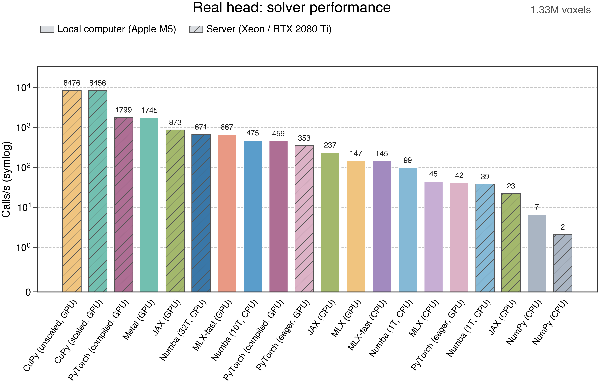

# 性能测试

[English](../en/performance.md) · [简体中文](performance.md) · [文档](index.md)

## 测试设置

测试使用同一组真实头模型电场：两组 FP32 数组，各含 **1,328,756 个体素**。一次求解计算全部体素的包络，图表中的“次/秒”由单次耗时中位数换算，数值取整数。

- **本机**：Apple M5，Numba 并行测试使用 10 线程；GPU 使用 Apple Metal。
- **服务器**：双路 Intel Xeon Gold 6230 和 NVIDIA RTX 2080 Ti；Numba 并行测试使用 32 线程。
- **计时**：预热 5 次、随机顺序同步测量 31 次；输入准备、设备传输和首次编译不计入；测试直接调用后端实现，CPU 与 GPU 分别运行。
- **校验**：所有方法使用相同输入，对照基于同一 FP32 输入的 NumPy float64 结果。服务器 CPU 进程限定在 32 个不同物理核，JAX 在该范围内由运行时管理线程。

## 真实头模型结果



| Apple M5 | 次/秒 | Xeon / RTX 2080 Ti | 次/秒 |
| --- | ---: | --- | ---: |
| Metal GPU | 1,745 | CuPy GPU，非缩放版 | 8,476 |
| MLX GPU，fast | 667 | CuPy GPU，缩放版 | 8,456 |
| Numba CPU，10 线程 | 475 | PyTorch GPU，编译 | 1,799 |
| PyTorch GPU，编译 | 459 | JAX GPU | 873 |
| JAX CPU | 237 | Numba CPU，32 线程 | 671 |
| MLX GPU | 147 | PyTorch GPU，eager | 353 |
| MLX CPU，fast | 145 | Numba CPU，1 线程 | 39 |
| Numba CPU，1 线程 | 99 | JAX CPU | 23 |
| MLX CPU | 45 | NumPy CPU | 2 |
| PyTorch GPU，eager | 42 | — | — |
| NumPy CPU | 7 | — | — |

PyTorch 测量使用原始基准公式；CuPy 非缩放版和 MLX-fast 是面向常见幅值的对照实现。图中其余缩放实现使用稳健求解公式。结果反映所列软硬件、线程数和输入下的性能。

[排行榜 PDF](../../benchmark_results/real_head_all_methods.pdf) · [优化示意图 PDF](../../benchmark_results/envelope_optimization.pdf) · [可编辑示意图](../../benchmark_results/envelope_optimization.drawio)

## 各平台图表

| 平台 | CPU | GPU | CPU / GPU 对比 |
| --- | --- | --- | --- |
| Apple M5 | [PDF](../../benchmark_results/cpu_performance.pdf) · [PNG](../../benchmark_results/cpu_performance.png) | [PDF](../../benchmark_results/gpu_performance.pdf) · [PNG](../../benchmark_results/gpu_performance.png) | [PDF](../../benchmark_results/cpu_gpu_comparison.pdf) · [PNG](../../benchmark_results/cpu_gpu_comparison.png) |
| Xeon / RTX 2080 Ti | [PDF](../../benchmark_results/server_cpu_performance.pdf) · [PNG](../../benchmark_results/server_cpu_performance.png) | [PDF](../../benchmark_results/server_gpu_performance.pdf) · [PNG](../../benchmark_results/server_gpu_performance.png) | [PDF](../../benchmark_results/server_cpu_gpu_comparison.pdf) · [PNG](../../benchmark_results/server_cpu_gpu_comparison.png) |

平台图包含不同规模合成输入的吞吐量、耗时和数值误差，以及真实头模型的结果。[优化说明](optimizations.md)介绍 Metal 和 CUDA 内核的计算方式。

## 数据与绘图

测量数据保存为 JSON，包含逐次耗时、误差、软硬件信息、输入哈希和源码哈希：

- Apple M5：[CPU](../../benchmark_results/cpu_measurements_jax_2026-11-03.json) · [GPU](../../benchmark_results/gpu_measurements_torch_compiled_2026-11-03.json)
- Xeon / RTX 2080 Ti：[CPU](../../benchmark_results/server_cpu_base_final.json) · [CPU 32 线程](../../benchmark_results/server_cpu32_final.json) · [GPU](../../benchmark_results/server_gpu_final.json)

使用 `python -m pip install matplotlib` 安装 Matplotlib，然后在项目根目录运行以下命令重新绘制排行榜：

```bash
python benchmarks/plot_real_head_all.py \
  --local-cpu benchmark_results/cpu_measurements_jax_2026-11-03.json \
  --local-gpu benchmark_results/gpu_measurements_torch_compiled_2026-11-03.json \
  --server-cpu benchmark_results/server_cpu_base_final.json \
  --server-cpu32 benchmark_results/server_cpu32_final.json \
  --server-gpu benchmark_results/server_gpu_final.json \
  --output-dir benchmark_outputs
```

`benchmarks/plot_cpu_gpu.py` 和 `benchmarks/plot_server_cpu_gpu.py` 分别绘制两台机器的平台图；运行脚本并传入 `--help` 可查看参数。`benchmarks/benchmark_cpu_gpu.py` 可测量合成数据，也可输入一对 `(N, 3)` `.npy` 电场。`benchmarks/benchmark_server_cpu_gpu.py` 需要一对电场，并通过 `--existing-cupy-source` 指定原始 CuPy 基准源码；参数详见 `--help`。真实头模型电场不包含在仓库中。
